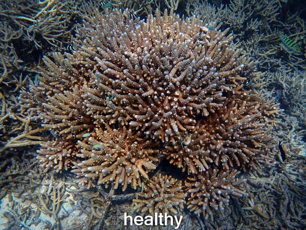
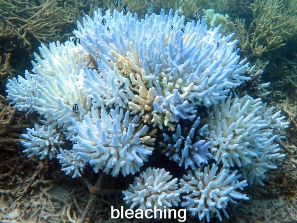
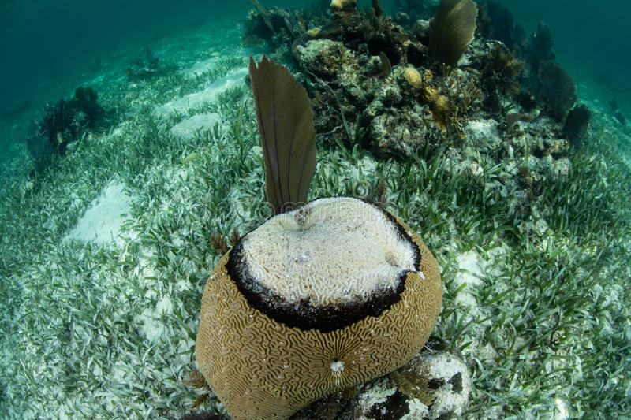
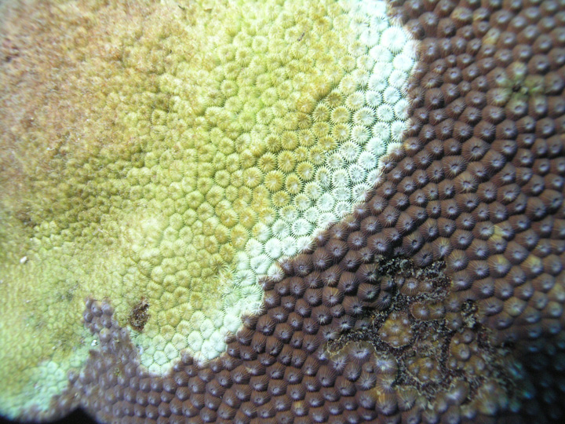
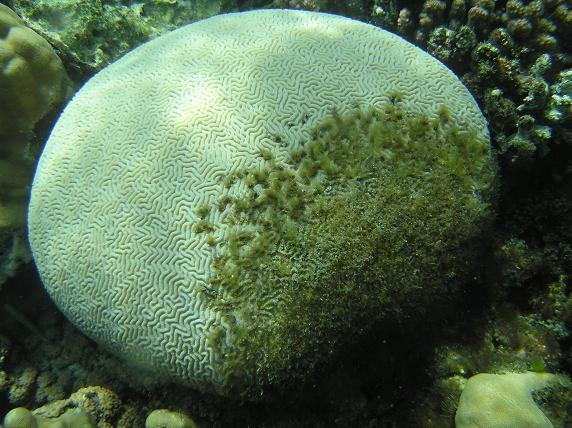
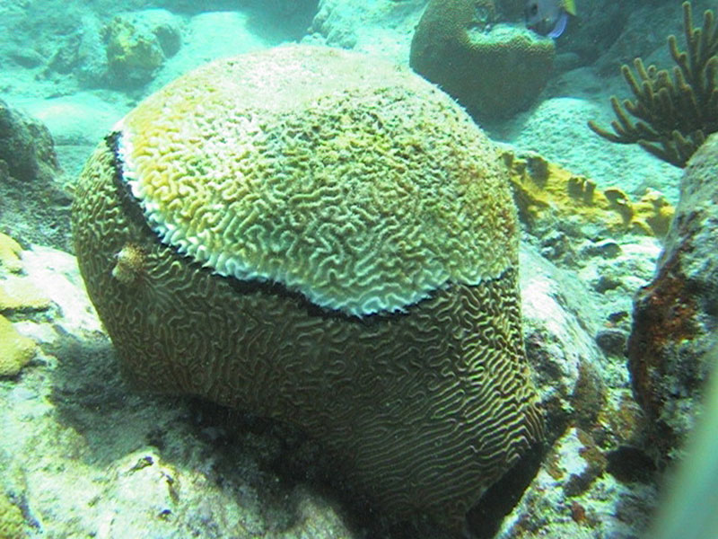
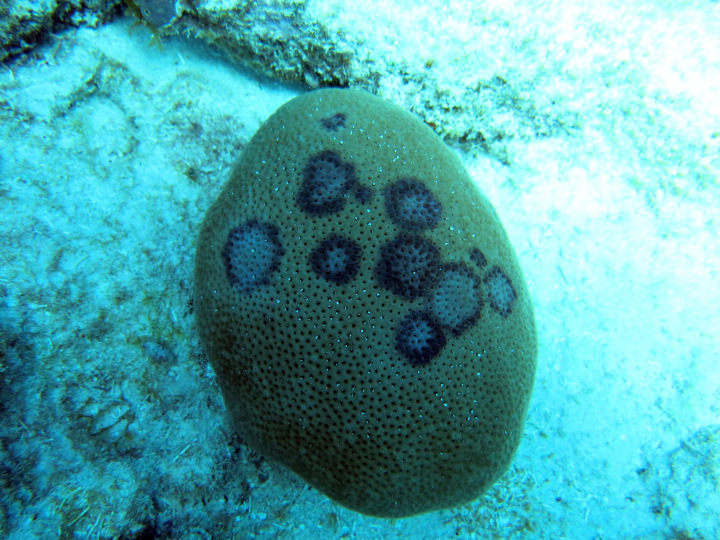
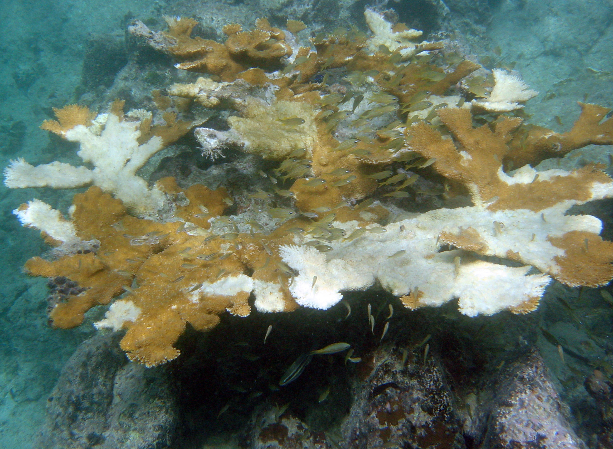
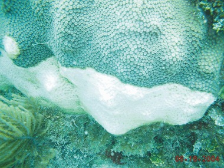

# Corals :telescope: :bar_chart:
Final project for **CAP 6737: Interactive Data Visualization** by Luis A. Rivera (2018).

## Abstract
The idea is to obtain a coral dataset containing coral information such as location, coral bleaching, or coral diseases with enough different corals and/or metrics to generate multiple visualizations of the data set for further analysis. A dashboard containing different graphs showing the information in different forms which could even lead to detecting any similarities in between the coral samples.

## Coral Datasets
Coral datasets available inside the `data` directory. Coral data sets descriptions can also be found in text format inside the `data` directory.

## Introduction
- [Coral Reefs 101 by National Geographic](https://www.youtube.com/watch?v=ZiULxLLP32s)

Other Videos:
- https://youtu.be/5ET2B-bEduc?t=5

## Coral Bleaching & Diseases
Coral Bleaching is the process by which coral losses its own major source of food which is algae surrounding it [Figure 1](https://github.com/gitluis/coralviz#figure-1-coral-bleaching). When algae leave the coral, it becomes vulnerable to diseases. This can be caused by many factors such as changes in ocean temperature, ocean pollution, overexposure to sunlight, extreme low tides, overall climate changes (CO2), ocean acidification (pH level changes), climate precipitation, altered ocean currents, storms, sea level rise, global warming and among many other [Figure 2](https://github.com/gitluis/coralviz#figure-2-coral-threats).

In addition, coral can be affected by diseases caused by infections from bacteria, viruses or stressors as previously mentioned in Figure 2 which slowly kill the coral by consuming the living tissue or leaving large patches of coral tissue to slough off exposing coral’s skeleton. Some of these diseases are Black-band disease, Dark-spot disease, Patchy necrosis (white pox), White plague, White-band disease, Yellow-band disease, Algae disease, Fungal disease and many others. See [Figure 3](https://github.com/gitluis/coralviz#figure-3-healthy-coral) to [Figure 11](https://github.com/gitluis/coralviz#figure-11-white-plague-type-2-disease) in [Appendix](https://github.com/gitluis/coralviz#appendix) for a visual picture of coral diseases.

## Data Preparation Summary
Data: `CoralBleaching.csv`

| Variable Name       | Variable Changes |
| :------------------ | :--------------- |
| id                  |                  |
| region              | Blanks recoded to NAs |
| subregion           | Blanks recoded to NAs |
| country             |                  |
| location            |                  |
| lat                 |                  |
| lon                 |                  |
| month               | Dropped          |
| year                |                  |
| depth               | Dropped          |
| severity_code       |                  |
| bleaching_severity  | Level "Severity Unknown" recoded to "Unknown" |
| coral_family        | Reduced levels from 121 to 23 |
| coral_species       |                  |
| percentage_affected | Conversion to Numeric |
| bleaching_duration  | Dropped          |
| mortality_code      | Conversion to Categorical & Reduced levels from 6 to 4 |
| mortality           | Conversion to Numeric |
| recovery_code       | Dropped          |
| recovery            | Dropped          |
| survey_type         | Dropped          |
| survey_area         | Dropped          |
| water_temperature   | Conversion to Numeric |
| other_factors       | Dropped          |
| remarks             | Dropped          |
| source              |                  |
| reference_code      | Dropped          |
| country_code        |                  |

Data: `CoralDisease.csv`

| Variable Name        | Variable Changes |
| :------------------- | :--------------- |
| id                   |                  |
| disease_type         | Reduced levels from 52 to 11 |
| year                 |                  |
| lat                  |                  |
| lon                  |                  |
| region               | Blanks recoded with NAs |
| subregion            | Blanks recoded with NAs |
| country              |                  |
| location             |                  |
| nearest_town         |                  |
| genus_species        |                  |
| percentage_incidence |                  |
| disease_remarks      | Dropped          |
| mortality_percentage |                  |
| diseased_percentage  |                  |
| reference_id         | Dropped          |
| remarks              | Dropped          |
| country_code         |                  |
| source               |                  |

## Data Visualization
- [Coral Bleaching Data Viz](https://public.tableau.com/profile/luis.rivera4167#!/vizhome/CoralBleachingDataViz/CoralBleachingDataViz)

| Dashboard | Description |
| :-------- | :---------- |
| Bleaching Observations Map | Coral reef observations colored by bleaching severity across the world. |
| Coral Severity Levels | Overall number of coral reefs per bleaching severity (class). |
| Coral Mortality Levels | Overall number of coral reefs per mortality level (class). |
| Water Temperature over Years | Average water temperature over the years captured. Also displays it by bleaching severity. |
| Percentage of Corals Bleached by Water Temperature | Percentage of corals bleached during observation as water temperature increases (hotter). |
| Percentage of Corals Bleached by Mortality Level | Percentage of corals bleached during observation as mortality level increases. |

- [Coral Disease Data Viz](https://public.tableau.com/profile/luis.rivera4167#!/vizhome/CoralDiseaseDataViz/CoralDiseaseDataViz)

| Dashboard | Description |
| :-------- | :---------- |
| Disease Observations Map | Coal reef observations colored by disease type across the world. |
| Coral Diseases | Overall number of coral reefs per disease. |
| Percentage of Coral Disease by Area Affected | Percentage of coral disease incidence (rate) versus diseases area affected in the coral reef. |
| Percentage of Coral Disease by Mortality Level | Percentage of coral disease incidence (rate) as mortality level increases. |

## License
Go to [LICENSE](https://github.com/gitluis/coralviz/blob/master/LICENSE) for more information. Any work from NOAA or ReefBase must follow their respective citation, licensing and terms accordingly. Go to [NOAA.gov](http://www.noaa.gov/) or [ReefBase.org](http://www.reefbase.org/main.aspx) for more information.

## References
Links checked October 31, 2026.

[1] NOAA National Ocean Service. "Are corals animals or plants?" https://oceanservice.noaa.gov/facts/coral.html. Accessed April 21, 2018.

[2] ReefBase: A Global Information System for Coral Reefs. http://www.reefbase.org. Accessed March 2018. The site is now offline; see `data/README.md` for how to cite the data.

[3] National Geographic. "Coral Reefs 101." YouTube, November 7, 2017. https://www.youtube.com/watch?v=ZiULxLLP32s.

[4] NOAA National Ocean Service. "What is coral bleaching?" https://oceanservice.noaa.gov/facts/coral_bleach.html. Accessed March 2018.

[5] NOAA National Ocean Service. "How does climate change affect coral reefs?" https://oceanservice.noaa.gov/facts/coralreef-climate.html. Accessed March 2018.

[6] WorldFish. "Coral Bleaching Data." Harvard Dataverse, 2016. https://doi.org/10.7910/DVN/KUVQKY.

[7] UNEP-WCMC and NOAA. "Global Coral Disease Database" (legacy). 2010. https://resources.unep-wcmc.org/products/WCMC_PT045.

## Appendix
These images are included for informational and educational purposes only. Figures 1 and 2 are from the NOAA National Ocean Service [4][5]. Figures 3 to 11 were collected from public web sources in 2018, possibly including the references above, and their original sources were not recorded. None of these images are covered by this repository's MIT license, which applies to the code and documentation. If you own one of these images and would like it credited or removed, please open an issue.

##### Figure 1. Coral Bleaching

##### Figure 2. Coral Threats

##### Figure 3. Healthy Coral

##### Figure 4. Bleaching Coral

##### Figure 5. Black-band Disease

##### Figure 6. White-band Disease

##### Figure 7. White plague Disease

##### Figure 8. Yellow-band, White-band, Black-band Diseases

##### Figure 9. Dark-spot Disease

##### Figure 10. White Pox Disease

##### Figure 11. White Plague Type 2 Disease

