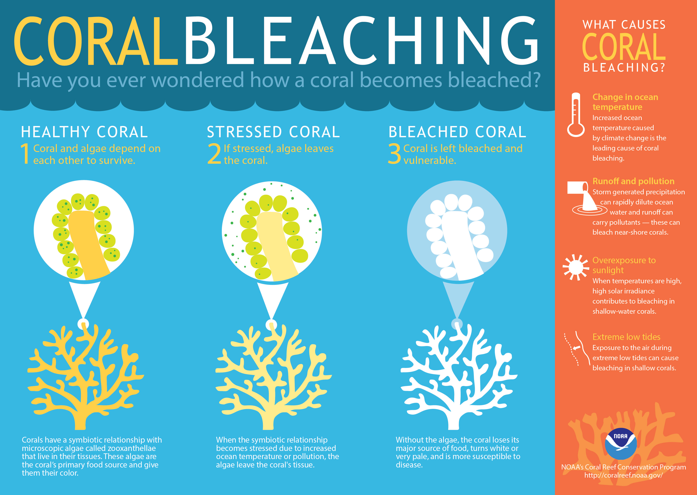
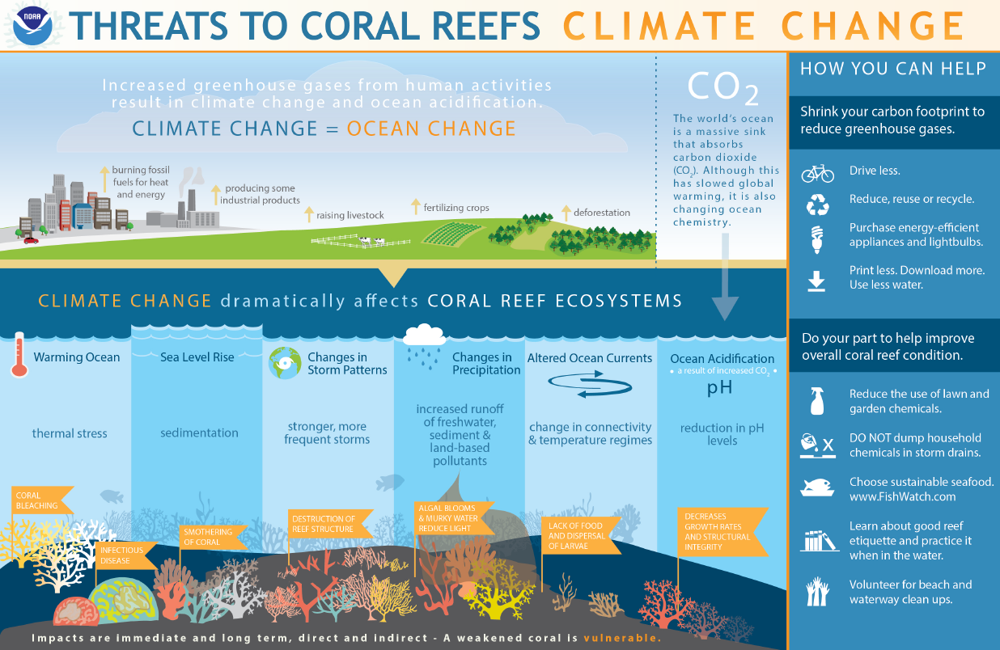

# Corals :telescope: :bar_chart:
| Course    | Course Name                    | Student        |
| :-------: | :----------------------------- | :------------- |
| CAP 6737  | Interactive Data Visualization | Luis A. Rivera |

## Summary
This project visualizes two global coral datasets from ReefBase: 6,190 coral bleaching observations (1963–2012) and 7,354 coral disease observations. The raw data were cleaned and recoded in R, then published as two interactive Tableau Public workbooks with maps, distributions, and scatter plots of bleaching and disease against water temperature, mortality, and area affected.

What the data shows:
- Disease records are concentrated in the Americas (69%, mostly the Caribbean). After "No disease" (1,494 records), the most reported diseases are black-band (1,248) and white-band (1,151).
- Mortality is unknown for 92% of bleaching observations, and water temperature is recorded for only 1,046 (17%), so the mortality and temperature views rest on a small subset of the data.

## Coral Datasets
Coral datasets available inside the `data` directory. Coral data sets descriptions can also be found in text format inside the `data` directory.

## Introduction
- [Coral Reefs 101 by National Geographic](https://www.youtube.com/watch?v=ZiULxLLP32s)

Other Videos:
- https://youtu.be/5ET2B-bEduc?t=5

## Coral Bleaching & Diseases
Coral bleaching is the process by which coral loses its main source of food: the algae living inside its tissue [Figure 1](#figure-1-coral-bleaching). When algae leave the coral, it becomes vulnerable to diseases. This can be caused by many factors such as changes in ocean temperature, ocean pollution, overexposure to sunlight, extreme low tides, overall climate changes (CO2), ocean acidification (pH level changes), climate precipitation, altered ocean currents, storms, sea level rise, global warming, among many others [Figure 2](#figure-2-coral-threats).

In addition, coral can be affected by diseases caused by infections from bacteria, viruses or stressors as previously mentioned in Figure 2 which slowly kill the coral by consuming the living tissue or leaving large patches of coral tissue to slough off exposing coral’s skeleton. Some of these diseases are Black-band disease, Dark-spot disease, Patchy necrosis (white pox), White plague, White-band disease, Yellow-band disease, Algae disease, Fungal disease and many others. See [Figure 3](#figure-3-healthy-coral) to [Figure 11](#figure-11-white-plague-type-2-disease) in [Appendix](#appendix) for a visual picture of coral diseases.

## Data Preparation Summary
The tables below describe how each cleaned file differs from its raw version (`*Raw.csv`). Blank changes mean the column was kept as is.

Data: `CoralBleaching.csv` (6,190 rows, from `CoralBleachingRaw.csv` by `bleaching_analysis.R`)

| Variable Name       | Variable Changes |
| :------------------ | :--------------- |
| id                  |                  |
| region              | Blanks recoded to the text "NA" (27 rows) |
| subregion           | Blanks recoded to the text "NA" (27 rows) |
| country             |                  |
| location            |                  |
| lat                 |                  |
| lon                 |                  |
| month               | Dropped          |
| year                |                  |
| depth               |                  |
| severity_code       |                  |
| bleaching_severity  | Level "Severity Unknown" recoded to "Unknown" |
| coral_family        | Families containing a comma or "and" grouped as "Mixed": 121 levels to 21 (counting blank). 95% of rows are blank |
| coral_species       |                  |
| percentage_affected | Conversion to Numeric (74% of rows blank) |
| bleaching_duration  | Dropped          |
| mortality_code      | Conversion to Categorical: codes 0–3 become No Mortality, Low, Medium, High; -1 and blank become Unknown (92% of rows) |
| mortality           | Conversion to Numeric; values over 100 set to blank |
| recovery_code       | Dropped          |
| recovery            | Dropped          |
| survey_type         | Dropped          |
| survey_area         | Dropped          |
| water_temperature   | Conversion to Numeric; values above 50 treated as Fahrenheit and converted to Celsius; capped at 32.22 °C (83% of rows blank) |
| other_factors       | Dropped          |
| remarks             | Dropped          |
| source              |                  |
| reference_code      | Dropped          |
| country_code        |                  |

Data: `CoralDiseases.csv` (7,354 rows, from `CoralDiseasesRaw.csv` by `diseases_analysis.R`)

| Variable Name        | Variable Changes |
| :------------------- | :--------------- |
| id                   |                  |
| disease_type         | Diseases with fewer than 125 records, and unspecified disease, grouped as "Other": 51 levels to 10 |
| year                 |                  |
| lat                  |                  |
| lon                  |                  |
| region               | Blanks recoded to the text "NA" (41 rows) |
| subregion            | Blanks recoded to the text "NA" (41 rows) |
| country              |                  |
| location             |                  |
| nearest_town         |                  |
| genus_species        |                  |
| percentage_incidence |                  |
| disease_remarks      | Dropped          |
| mortality_percentage |                  |
| diseased_percentage  |                  |
| reference_id         | Dropped          |
| remarks              | Dropped          |
| country_code         |                  |
| source               |                  |

### Known data issues
- One bleaching record (Tuo village, Solomon Islands) has latitude -10269, likely -10.269. It appears near Antarctica on the bleaching map.
- 19 bleaching records have water temperatures below 5 °C. These are probably temperature anomalies (degrees above normal) recorded in the same field, not absolute temperatures.
- Six disease records are dated 1780.
- Both disease files, `MonitoringSitesRaw.csv`, and `ReefLocationsRaw.csv` are Latin-1 encoded, not UTF-8.

## Repository Layout
```
coralviz/
├── data/                 Raw (*Raw.csv) and cleaned CSVs, ReefBase field notes (*.txt), citation
├── images/               Figures used in this README
├── tableau/              Tableau workbooks and data extracts
├── bleaching_analysis.R  Cleans CoralBleachingRaw.csv into CoralBleaching.csv
├── diseases_analysis.R   Cleans CoralDiseasesRaw.csv into CoralDiseases.csv
└── lower_header.py       One-off helper that lowercased CSV headers (legacy; its input file no longer exists)
```
`MonitoringSitesRaw.csv` and `ReefLocationsRaw.csv` were downloaded with the other datasets but are not used in the visualizations.

## How to Reproduce
The scripts were written in 2018 for R 3.x and need two small changes to run today.

1. Install R and the packages `ggplot2` and `stringr`.
2. In each script, replace the `setwd("C:/Users/groot/...")` line with the path to your copy of this repository.
3. On R 4.0 or later, add `stringsAsFactors = TRUE` to the `read.csv()` call. Since R 4.0, text columns no longer load as factors, and the recoding steps depend on factors. For `diseases_analysis.R`, also add `fileEncoding = "latin1"`.
4. Run `bleaching_analysis.R` and `diseases_analysis.R`. They write `data/CoralBleaching.csv` and `data/CoralDiseases.csv`.
5. Open the workbooks in `tableau/` with Tableau Desktop or Tableau Public Desktop.

## Data Visualization
- [Coral Bleaching Data Viz](https://public.tableau.com/profile/luis.rivera4167#!/vizhome/CoralBleachingDataViz/CoralBleachingDataViz)

| Dashboard | Description |
| :-------- | :---------- |
| Bleaching Observations Map | Coral reef observations colored by bleaching severity across the world. |
| Coral Severity Levels | Overall number of coral reefs per bleaching severity (class). |
| Coral Mortality Levels | Overall number of coral reefs per mortality level (class). |
| Water Temperature over Years | Average water temperature over the years captured. Also displays it by bleaching severity. |
| Percentage of Corals Bleached by Water Temperature | Percentage of corals bleached during observation as water temperature increases (hotter). |
| Percentage of Corals Bleached by Mortality Level | Percentage of corals bleached during observation as mortality level increases. |


- [Coral Disease Data Viz](https://public.tableau.com/profile/luis.rivera4167#!/vizhome/CoralDiseaseDataViz/CoralDiseaseDataViz)

| Dashboard | Description |
| :-------- | :---------- |
| Disease Observations Map | Coral reef observations colored by disease type across the world. |
| Coral Diseases | Overall number of coral reefs per disease. |
| Percentage of Coral Disease by Area Affected | Percentage of coral disease incidence (rate) versus diseases area affected in the coral reef. |
| Percentage of Coral Disease by Mortality Level | Percentage of coral disease incidence (rate) as mortality level increases. |

## License
Go to [LICENSE](https://github.com/gitluis/coralviz/blob/master/LICENSE) for more information. Any work from NOAA or ReefBase must follow their respective citation, licensing and terms accordingly. Go to [NOAA.gov](http://www.noaa.gov/) or [ReefBase.org](http://www.reefbase.org/main.aspx) for more information.

## References
[1] NOAA. Are corals animals or plants? National Ocean Service website, https://oceanservice.noaa.gov/facts/coral_bleach.html, accessed on 04/21/2018.

[2] ReefBase: A Global Information System for Coral Reefs. March, 2018. http://www.reefbase.org.

[3] National Geographic. Coral Reefs 101 | National Geographic. November 7, 2017. https://youtu.be/ZiULxLLP32s.

[4] NOAA. What is coral bleaching? National Ocean Service website, https://oceanservice.noaa.gov/facts/coral_bleach.html, accessed on March 2018.

[5] NOAA. How does climate change affect coral reefs? National Ocean Service website, https://oceanservice.noaa.gov/facts/coralreef-climate.html, accessed on March 2018.

## Appendix
##### Figure 1. Coral Bleaching


##### Figure 2. Coral Threats


##### Figure 3. Healthy Coral


##### Figure 4. Bleaching Coral


##### Figure 5. Black-band Disease


##### Figure 6. White-band Disease


##### Figure 7. White plague Disease


##### Figure 8. Yellow-band, White-band, Black-band Diseases


##### Figure 9. Dark-spot Disease


##### Figure 10. White Pox Disease


##### Figure 11. White Plague Type 2 Disease

